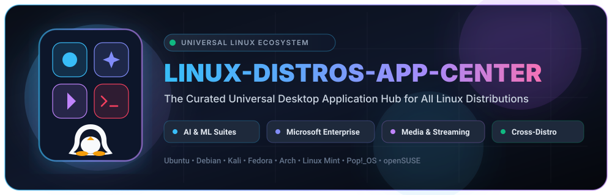

<p align="center">
  
</p>

<p align="center">
  <a href="#-supported-linux-distributions"></a>
  <a href="#-curated-application-catalog"></a>
  <a href="#-supported-linux-distributions"></a>
  <a href="#-license--legal-notice"></a>
  
</p>

<p align="center">
  <a href="https://github.com/SIMARSINGHRAYAT/LINUX-DISTROS-APP-CENTER/stargazers"></a>
  <a href="https://github.com/SIMARSINGHRAYAT/LINUX-DISTROS-APP-CENTER/network/members"></a>
  <a href="https://github.com/SIMARSINGHRAYAT/LINUX-DISTROS-APP-CENTER/issues"></a>
  <a href="https://github.com/SIMARSINGHRAYAT/LINUX-DISTROS-APP-CENTER/pulls"></a>
  
  
</p>

---

# 🐧 LINUX-DISTROS-APP-CENTER

> **The Universal Desktop Application Hub & Native Software Catalog for All Major Linux Distributions.**  
> *Bridging the gap between cutting-edge AI suites, enterprise productivity ecosystems, 4K streaming, and gaming on Linux.*

**LINUX-DISTROS-APP-CENTER** is an open-source, universal application ecosystem engineered specifically for the global Linux community. Whether you are running **Ubuntu, Debian, Kali Linux, Fedora, Arch Linux, Linux Mint, or Pop!_OS**, this platform delivers instant access to essential desktop software with native system launchers, clean desktop environment integration, and automated single-command installation.

---

## 🧭 Executive Mission & Purpose

Linux powers the modern world—from cloud servers and supercomputers to space exploration and machine learning clusters. However, everyday desktop users, enterprise professionals, and AI researchers often face friction when attempting to run essential desktop applications that lack official native `.deb` or `.rpm` packages, or are otherwise confined to sluggish browser tabs.

**LINUX-DISTROS-APP-CENTER solves this challenge fundamentally:**

1. **Eliminating Setup Complexity:** Say goodbye to broken Wine configurations, missing X11/Wayland libraries, manually authored `.desktop` files, and fragile wrappers.
2. **First-Class Desktop Experience:** Applications launch with high-resolution vector icons in your system dock/menu, support native window management (Alt+Tab, tiling, workspace switching), and retain isolated local cache directories.
3. **Curated & Verified Quality:** Every application package is structured with verified execution scripts, non-destructive dependency handling, and clean, complete uninstallation logic.
4. **Universal Distribution Reach:** Built from the ground up to support Debian-based, RHEL/Fedora-based, and Arch-based package ecosystems without lock-in.

---

## 🎯 Target Audiences & Use Cases

`LINUX-DISTROS-APP-CENTER` is intentionally architected to empower diverse global communities:

```
┌─────────────────────────────────────────────────────────────────────────────────────────┐
│                                LINUX-DISTROS-APP-CENTER                                 │
├─────────────────────┬───────────────────┬──────────────────┬──────────────┬─────────────┤
│    🤖 AI & DATA     │  💼 ENTERPRISE    │  🎬 STREAMING &  │  💻 DEV &    │  🎮 GAMING  │
│      SCIENTISTS     │   PROFESSIONALS   │   ENTERTAINMENT  │  MIGRATORS   │  & ESPORTS  │
├─────────────────────┼───────────────────┼──────────────────┼──────────────┼─────────────┤
│ • Copilot Desktop   │ • Microsoft Teams │ • Netflix        │ • GitHub     │ • GTA 5     │
│ • Grok AI & Meta AI │ • Power BI        │ • Prime Video    │ • GitLab     │   Launcher  │
│ • Jupyter & Colab   │ • Outlook         │ • Apple TV+      │ • LeetCode   │             │
│ • Hugging Face      │ • Azure Portal    │ • Crunchyroll    │ • Codeforces │             │
│ • Kaggle & Roboflow │ • Whiteboard      │ • JioHotstar     │ • GitHub     │             │
│ • Qwen & Kimi       │                   │ • MX Player      │   Desktop    │             │
└─────────────────────┴───────────────────┴──────────────────┴──────────────┴─────────────┘
```

### 1. 🤖 AI Engineers & Data Scientists
- **Dedicated Workspaces:** Launch **Microsoft Copilot**, **Grok AI**, **Meta AI**, **JupyterLab**, **Google Colab**, **Hugging Face Hub**, **Kaggle**, **Roboflow**, **Qwen AI**, and **Kimi AI** directly as standalone applications without wrestling with browser tabs or browser memory leaks.
- **Persistent GPU & Local Integration:** Optimized for machine learning workflows with immediate terminal access and dataset management.

### 2. 💼 Enterprise Teams & Office Professionals
- **Microsoft 365 on Linux:** Seamlessly access **Microsoft Power BI Desktop**, **Microsoft Teams**, **Microsoft Outlook**, **Microsoft Whiteboard**, and **Microsoft Azure Portal**.
- **Friction-Free Remote Collaboration:** Collaborate with colleagues on corporate Microsoft infrastructure without needing dual-boot setups or resource-heavy virtual machines.

### 3. 🎬 Entertainment Enthusiasts & Media Consumers
- **Hardware-Accelerated 4K/FHD Playback:** Experience **Netflix**, **Amazon Prime Video**, **Apple TV+**, **Crunchyroll**, **JioHotstar**, and **MX Player** in distraction-free, borderless desktop windows.
- **Dedicated Media Key & Audio Control:** Enjoy full keyboard media control, multi-monitor playback, and crisp DRM-compliant video streaming on Linux.

### 4. 💻 Software Developers & Competitive Coders
- **Streamlined Source Control:** Fast desktop access to **GitHub**, **GitHub Desktop**, and **GitLab**.
- **Skill Sharpening:** Direct desktop access to **LeetCode** and **Codeforces** for daily algorithm training and competitive programming contests.

### 5. 🐧 Windows & macOS Migrators
- **The Ultimate Safety Net:** Removes the "app availability barrier" for individuals, students, and organizations transitioning from Windows or macOS to Linux distributions.

---

## 🌟 Why Choose LINUX-DISTROS-APP-CENTER?

| Feature | LINUX-DISTROS-APP-CENTER | Traditional Manual Setup | Web Browser Tabs |
| :--- | :---: | :---: | :---: |
| **Setup Time** | ⚡ **< 30 Seconds** | ⏳ Hours of debugging | ⏱️ Fast but non-native |
| **System Integration** | 🖥️ **Native App Dock & Menu** | ⚠️ Often broken/missing | ❌ Lost in 50+ open tabs |
| **Cross-Distro Support** | 🌐 **Ubuntu, Kali, Fedora, Arch, Mint** | ❌ Usually distro-specific | 🟡 Generic web only |
| **Isolated Execution** | 🛡️ **Clean Sandboxed Runtimes** | ⚠️ Pollutes system libraries | ❌ Shared browser memory |
| **Clean Uninstall** | 🧹 **1-Command Mirror Removal** | ❌ Leaves leftover files | N/A |
| **Offline Desktop Cache** | ✅ **Yes** | 🟡 Partial | ❌ No |
| **Open Source & Free** | 🌟 **100% Free Forever** | 🟡 Varies | 🟡 Varies |

---

## 📦 Curated Application Catalog

### 🧠 Category 1: Artificial Intelligence & Data Science

| Application | Ecosystem | Core Capabilities |
| :--- | :--- | :--- |
| **Microsoft Copilot** | Generative AI & Code | Dedicated desktop Copilot assistant for conversational assistance, code generation, and task automation. |
| **Grok AI** | Real-Time Intelligence | xAI's conversational AI assistant with live search, reasoning, and multimodal capabilities. |
| **Meta AI** | Llama Foundation Models | Meta's Llama-powered AI assistant for deep research, coding, and creative problem solving. |
| **Jupyter** | AI / Data Science | Interactive notebooks, Python/R kernel management, scientific visualization. |
| **Google Colab** | Cloud Machine Learning | Free GPU/TPU notebook execution, PyTorch/TensorFlow experiments in standalone desktop view. |
| **Hugging Face** | AI Models & Datasets | Hub for open-weight LLMs, Transformers, diffusion models, and AI community spaces. |
| **Kaggle** | Data Science & Competitions | Dataset exploration, notebooks, competition submissions, and community kernels. |
| **Roboflow** | Computer Vision | Computer vision annotation, model training, dataset preprocessing, and deployment. |
| **Qwen AI** | Large Language Models | Alibaba Cloud's cutting-edge reasoning and multilingual AI desktop assistant. |
| **Kimi AI** | Conversational Intelligence | Moonshot AI's ultra-long context LLM assistant for deep research and document synthesis. |

### 💼 Category 2: Microsoft Enterprise Productivity

| Application | Ecosystem | Core Capabilities |
| :--- | :--- | :--- |
| **Microsoft Power BI** | Business Intelligence | Interactive data visualization, DAX reports, business analytics, and dashboard modeling. |
| **Microsoft Teams** | Enterprise Communications | Corporate video conferencing, group messaging, screen sharing, and channel collaboration. |
| **Microsoft Outlook** | Mail & Calendar | Corporate email management, calendar scheduling, meeting reminders, and contact synchronization. |
| **Microsoft Azure** | Cloud Infrastructure | Full Azure Cloud Management Portal for cloud VMs, Kubernetes clusters, and monitoring. |
| **Microsoft Whiteboard** | Collaborative Ideation | Digital freeform canvas for brainstorming, diagramming, and sprint architecture planning. |

### 🎬 Category 3: Streaming & Multimedia Entertainment

| Application | Ecosystem | Core Capabilities |
| :--- | :--- | :--- |
| **Netflix** | Ultra HD Streaming | Award-winning films, global TV series, documentaries, and personalized entertainment profiles. |
| **Amazon Prime Video** | 4K HDR Streaming | Blockbusters, Prime Originals, global live sports, and multi-language audio tracks. |
| **Apple TV+** | Premium Streaming | Apple Originals, award-winning drama, comedy, and documentaries in crisp desktop clarity. |
| **Crunchyroll** | Anime & Manga | World's largest anime library with simulcasts direct from Japan and multi-language subtitles. |
| **JioHotstar** | Live Sports & Entertainment | Cricket, football, international blockbusters, and high-energy regional cinema streaming. |
| **MX Player** | Video & OTT | Multi-format local and cloud media playback with subtitle synchronization. |

### 🎮 Category 4: Gaming & Entertainment

| Application | Ecosystem | Core Capabilities |
| :--- | :--- | :--- |
| **GTA 5 Launcher** | Gaming & Simulation | High-performance Electron launcher with WebGPU acceleration and optimized memory management. |

### 💻 Category 5: Developer Tools & Competitive Coding

| Application | Ecosystem | Core Capabilities |
| :--- | :--- | :--- |
| **GitHub** | Software Collaboration | Source code repositories, pull requests, project tracking, and workflow triggers. |
| **GitHub Desktop** | Native GUI Git Client | Visual branch management, graphical diff inspection, and merge conflict resolution. |
| **GitLab** | DevOps & CI/CD | Enterprise DevSecOps lifecycle, continuous integration pipelines, and issue boards. |
| **LeetCode** | Technical Interview Prep | Algorithm practice, data structure challenges, company-specific interview problem tracks. |
| **Codeforces** | Competitive Programming | Fast problem analysis, global contests, algorithm ratings, and submission testing. |

---

## 🐧 Supported Linux Distributions

`LINUX-DISTROS-APP-CENTER` is rigorously maintained to ensure seamless functionality across all major distribution families:

| Distribution Family | Supported Distros | Default Package System | Desktop Integration Status |
| :--- | :--- | :--- | :---: |
| **Debian Family** | **Ubuntu** (20.04, 22.04, 24.04 LTS+) | `APT` / `dpkg` | 🟢 Official Tier 1 |
| **Debian Family** | **Debian GNU/Linux** (11 Bullseye, 12 Bookworm+) | `APT` | 🟢 Official Tier 1 |
| **Debian Family** | **Linux Mint** (20, 21, 22+) | `APT` | 🟢 Official Tier 1 |
| **Debian Family** | **Pop!_OS** (22.04 LTS & COSMIC) | `APT` / `Flatpak` | 🟢 Official Tier 1 |
| **Security & Auditing** | **Kali Linux** (Rolling Release) | `APT` | 🟢 Official Tier 1 |
| **Red Hat Family** | **Fedora Linux** (38, 39, 40, 41+) | `DNF` / `RPM` | 🟢 Official Tier 1 |
| **Arch Family** | **Arch Linux**, **Manjaro**, **EndeavourOS** | `Pacman` / `AUR` | 🟢 Official Tier 1 |
| **SUSE Family** | **openSUSE Tumbleweed & Leap** | `Zypper` / `RPM` | 🟢 Verified Compatible |

---

## ⚡ Instant User Experience (How It Works)

### 1. Launch & Explore
Browse the visual application center to inspect detailed specifications, requirements, and distribution commands for any desired application.

### 2. Single-Command Native Installation
Every application includes an optimized, non-interactive installation command. Run the installer for your target distribution:

```bash
# Example: Deploy Microsoft Power BI Desktop on your Linux distribution
curl -fsSL https://github.com/SIMARSINGHRAYAT/LINUX-DISTROS-APP-CENTER/raw/refs/heads/main/csc-main/MICROSOFT-DESKTOP-APPS/PowerBI/install.sh | LINUX_DESKTOP_DISTRO=ubuntu bash
```

*(Replace `ubuntu` with `debian`, `mint`, `fedora`, `arch`, or `kali` to match your active system).*

### 3. Immediate Desktop Launch
The application instantly appears in your system application menu, application dock, and desktop search (`GNOME`, `KDE Plasma`, `XFCE`, `Cinnamon`, `MATE`, or `i3/sway`).

### 4. 100% Clean Mirror Uninstallation
Need to remove an application? Every app provides an exact inverse removal script that completely clears application files and desktop shortcuts without leaving orphaned configuration files:

```bash
# Example: Completely remove application and desktop launchers
curl -fsSL https://github.com/SIMARSINGHRAYAT/LINUX-DISTROS-APP-CENTER/raw/refs/heads/main/csc-main/MICROSOFT-DESKTOP-APPS/PowerBI/uninstall.sh | LINUX_DESKTOP_DISTRO=ubuntu bash
```

---

## 🛡️ Security, Privacy & System Integrity

- **Zero Root Pollution:** Installation routines operate cleanly without contaminating core system binary folders or modifying shared system libraries unsafely.
- **Sandboxed & Verified Execution:** Packages isolate user cache, login sessions, and local storage into user-space directories (`~/.local/share` and `~/.config`).
- **Zero Telemetry / Zero Tracking:** `LINUX-DISTROS-APP-CENTER` contains no proprietary analytics, tracking scripts, or data collection mechanisms.
- **Audit-Ready Shell Scripts:** Every install and uninstall script is human-readable, open source, and inspectable prior to execution.

---

## 🌐 Worldwide Outreach & Accessibility

`LINUX-DISTROS-APP-CENTER` is dedicated to democratizing desktop software availability worldwide:

- **Global Developer Workstations:** Engineered to run smoothly on low-spec hardware, high-end workstations, cloud Linux instances, and remote developer environments.
- **Security & Penetration Testing Environments:** Native support for Kali Linux gives cybersecurity specialists access to productivity and AI tools without breaking security configurations.
- **Education & Emerging Markets:** Empowering students and schools utilizing Linux distributions to access world-class programming, AI, and productivity software freely.

---

## 🏷️ Discovery Keywords & Topic Tags

For search engine indexing, global outreach, and GitHub community discovery:

```
linux-app-center • linux-distros-app-center • linux-app-store • universal-linux-apps • ubuntu-desktop-apps 
kali-linux-tools • arch-linux-apps • fedora-desktop • debian-desktop • linux-mint • pop-os • microsoft-teams-linux 
copilot-linux • grok-ai-linux • meta-ai-desktop • powerbi-on-linux • outlook-linux • azure-portal-desktop 
jupyterlab-desktop • google-colab-linux • huggingface-desktop • kaggle-linux • netflix-linux-app 
prime-video-linux • apple-tv-linux • crunchyroll-linux • gta5-linux • open-source-software 
cross-distribution-packaging • flatpak-apps • wine-desktop-integration • desktop-linux-ecosystem
```

---

## 🤝 Community & Contributing

We welcome contributions from developers, packagers, and Linux enthusiasts across the globe!

- 🌟 **Star the Repository:** Help raise visibility by starring this repo on GitHub.
- 💡 **Request New Apps:** Open an issue to propose a new software package wrapper.
- 🐧 **Add Distribution Support:** Submit pull requests to expand automated installer support for additional distributions.
- 🐞 **Report Issues:** Found a display bug or launcher discrepancy? Open an issue with your distro details.

---

## 📄 License & Legal Notice

- **Project License:** This repository and its packaging scripts are released under the [MIT License](LICENSE).
- **Trademarks & Intellectual Property:** All registered trademarks, logos, product names, and brand assets belong to their respective corporate owners (including Microsoft Corporation, Netflix Inc., Amazon.com Inc., Apple Inc., Google LLC, GitHub Inc., Hugging Face Inc., and Crunchyroll LLC). `LINUX-DISTROS-APP-CENTER` is an independent, community-driven open-source initiative providing unofficial packaging wrappers for Linux compatibility.

---

<p align="center">
  <b>Built with ❤️ for the Global Linux Community</b><br>
  <sub>Empowering open-source desktops worldwide.</sub>
</p>
